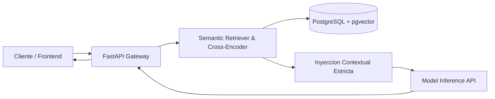

# Enterprise RAG Service with FastAPI and pgvector


Arquitectura de referencia para un microservicio desacoplado de Retrieval-Augmented Generation (RAG) en produccion, disenado para garantizar baja latencia, respuestas estrictamente ancladas a datos contextuales y mitigacion de alucinaciones.

## Arquitectura del Sistema



## Decisiones de Diseno (ADR)
- FastAPI Asincrono: Concurrencia nativa para llamadas hacia modelos de inferencia y bases de datos vectoriales.
- pgvector en PostgreSQL: Unificacion de datos transaccionales relacionales y vectores de embeddings bajo un unico motor ACID.
- Validacion Estricta con Pydantic v2: Contratos de datos deterministas para entrada, salida y llamadas a herramientas (tool calling).

## Despliegue Rapido Local

```bash
# 1. Clonar el repositorio
git clone git@github.com:nicanorferrari/enterprise-rag-fastapi.git
cd enterprise-rag-fastapi

# 2. Iniciar contenedores con Docker
docker compose up -d

# 3. Documentacion interactiva Swagger
# Acceder a http://localhost:8000/docs
```

